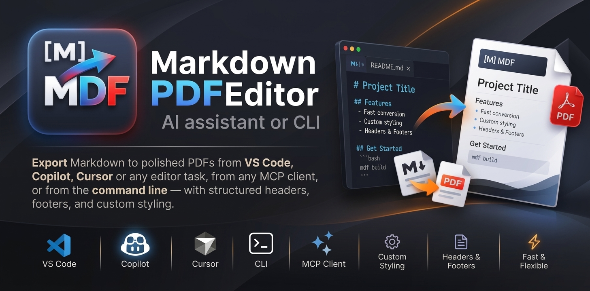
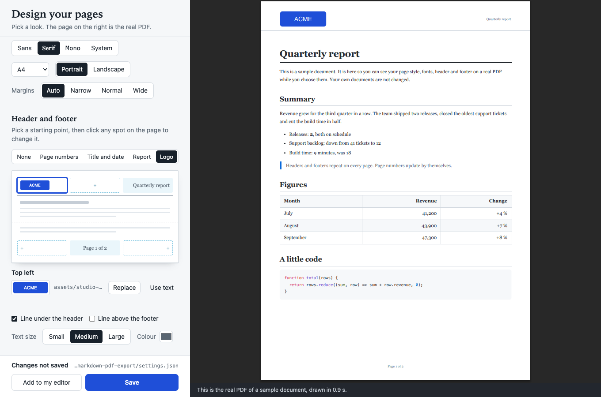

# Markdown PDF Export

[](https://www.npmjs.com/package/markdown-pdf-export)
[](https://www.npmjs.com/package/markdown-pdf-export)
[](https://github.com/matinfo-tech/markdown-pdf-export/actions/workflows/ci.yml)
[](https://github.com/matinfo-tech/markdown-pdf-export/blob/main/LICENSE)

Turn Markdown files into clean PDFs from VS Code, Zed, Cursor, Claude or any AI assistant, or from
the command line.

<p align="center">
  
</p>

Full documentation: <https://markdown-pdf.matinfo.tech/>



## Get started

> **Using VS Code?** Install the
> [Markdown PDF Export extension](https://marketplace.visualstudio.com/items?itemName=matinfo-tech.markdown-pdf-export)
> ([Open VSX](https://open-vsx.org/extension/matinfo-tech/markdown-pdf-export)): the PDF beside your Markdown as you type, Studio in the
> editor, export and the Copilot tools. No Node.js, no terminal.

Everywhere else, you need:

- **Node.js 20 or newer** (it comes with `npx`).
- **Google Chrome or Microsoft Edge.** No Chromium browser? Run
  `npx -y markdown-pdf-export install-browser` once (about 200 MB).

Then run this line in a terminal:

```sh
npx -y markdown-pdf-export studio
```

Studio opens in your browser. Pick a page style, fonts, paper size, header and footer, and watch the
real PDF update as you go. Click **Save**, then **Add to my editor**, and you are ready to export.

There is nothing to install first: `npx` downloads the package on first use and reuses it after.
Prefer the terminal? Run `npx -y markdown-pdf-export` with no arguments for a small menu.

More: [Get started](https://markdown-pdf.matinfo.tech/start) ·
[Studio](https://markdown-pdf.matinfo.tech/studio) ·
[Design online, no install](https://markdown-pdf.matinfo.tech/online)

## Export a file

| Where | How |
|---|---|
| VS Code, with the extension | <kbd>Cmd</kbd>+<kbd>K</kbd> <kbd>Cmd</kbd>+<kbd>E</kbd> (<kbd>Ctrl</kbd>+<kbd>K</kbd> <kbd>Ctrl</kbd>+<kbd>E</kbd>), or the button at the top right of the file |
| Your editor | Run the task *Markdown: Export to PDF* on the open file |
| AI assistant | Ask: "Export this file to PDF" |
| Terminal | `npx -y markdown-pdf-export report.md` |

The PDF is saved next to the Markdown file. To add the task or the assistant tool by hand, run
`npx -y markdown-pdf-export setup`, or see
[Editors](https://markdown-pdf.matinfo.tech/editors).

## What you get

- Five page styles: Clean, Report, Academic, Compact and Technical.
- Headers and footers with the title, page numbers, the date and your logo.
- Coloured code blocks, with a choice of colour themes.
- Maths with KaTeX: `$inline$` and `$$display$$`.
- A contents list from a `[[toc]]` marker, with links to each heading.
- Mermaid diagrams, task lists, footnotes and GitHub alerts (`> [!NOTE]`).
- Settings for one document in its front matter.
- One settings file used by every editor, the assistant and the terminal.
- Safe with documents you did not write: scripts, frames and event handlers in raw HTML are
  filtered out ([Raw HTML and safety](https://markdown-pdf.matinfo.tech/advanced/content#raw-html-and-safety)).

## Go further

- [Advanced topics](https://markdown-pdf.matinfo.tech/advanced/): a one-page map of everything below.
- [Settings file](https://markdown-pdf.matinfo.tech/advanced/settings-file): where it lives and how files are combined.
- [Per-document settings](https://markdown-pdf.matinfo.tech/advanced/per-document): change one document with front matter.
- [Header and footer](https://markdown-pdf.matinfo.tech/advanced/header-footer): zones, logos, page numbers and dates.
- [Styling](https://markdown-pdf.matinfo.tech/advanced/styling): your own CSS, fonts and code colours.
- [Content](https://markdown-pdf.matinfo.tech/advanced/content): maths, contents list, images and page breaks.
- [Command line](https://markdown-pdf.matinfo.tech/advanced/cli): every command and option.
- [Assistant tools](https://markdown-pdf.matinfo.tech/advanced/assistant-tools): the MCP server and its two tools.
- [Browser](https://markdown-pdf.matinfo.tech/advanced/browser): which browser is used and how to pick another.
- [Recipes](https://markdown-pdf.matinfo.tech/advanced/recipes): ready-made setups for common jobs.
- [Settings reference](https://markdown-pdf.matinfo.tech/reference/settings): every setting.
- [Placeholders reference](https://markdown-pdf.matinfo.tech/reference/placeholders): `{page}`, `{title}`, `{date}` and more.

## Help

Check the browser and your settings in one step:

```sh
npx -y markdown-pdf-export doctor
```

You can also ask the assistant: "Run doctor_markdown_pdf". For common problems, see
[Help](https://markdown-pdf.matinfo.tech/help).

## Contributing

See [CONTRIBUTING.md](https://github.com/matinfo-tech/markdown-pdf-export/blob/main/CONTRIBUTING.md) for development setup, tests and how the project is built.

## Licence

MIT. See [LICENSE](https://github.com/matinfo-tech/markdown-pdf-export/blob/main/LICENSE).
